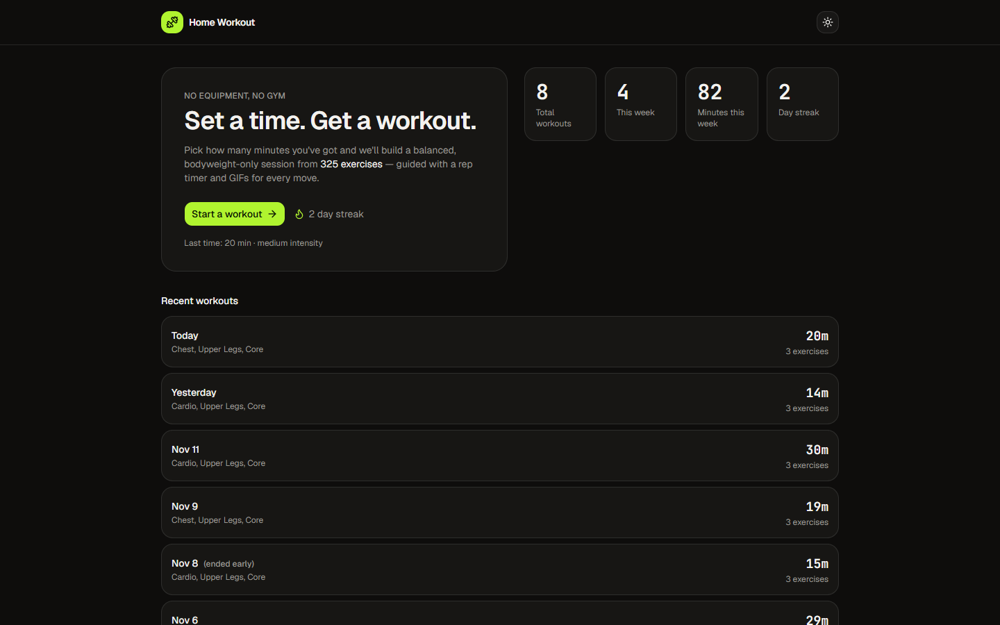
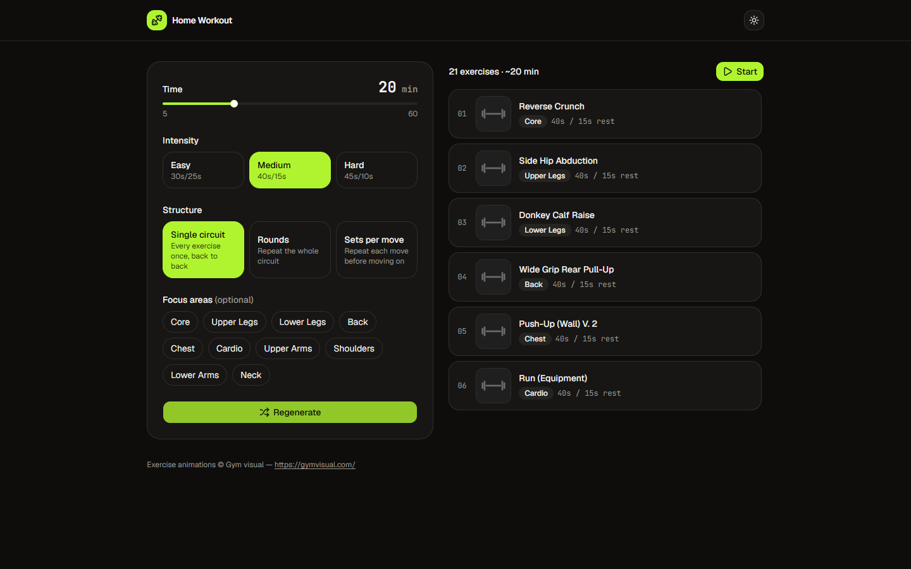
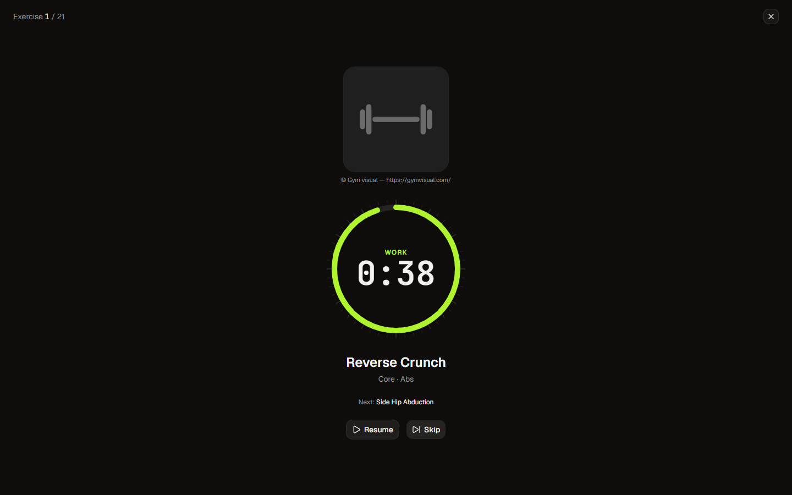
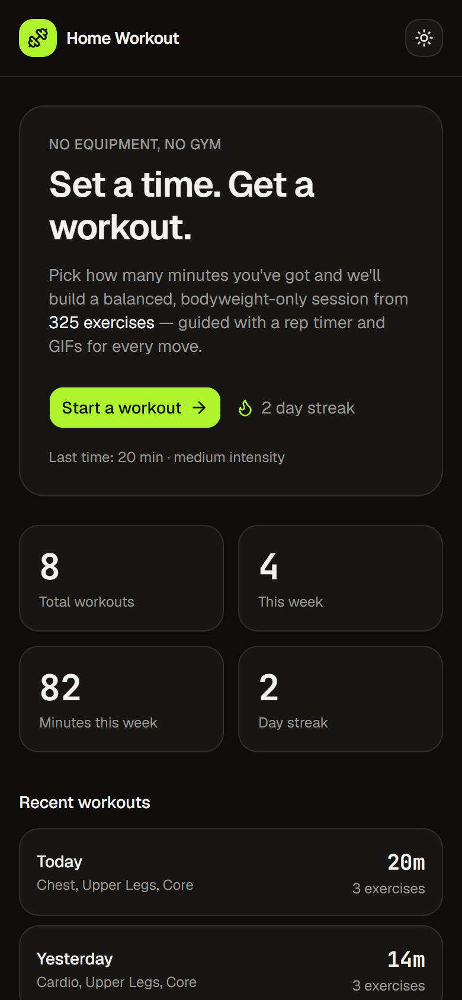

# Home Workout

**Landing page:** https://fitness-app-miguel.vercel.app

An installable PWA that turns "I have 20 minutes" into a balanced home workout you can do with little or no equipment. Pick a time budget, an intensity and a structure, and you get a time-boxed sequence of bodyweight exercises with an animated GIF and a guided work/rest timer for each one.

<p align="center">
  
</p>

## Features

- **Workout generator.** A time slider from 5 to 60 minutes, three intensity presets and three structures. The generator fills the time budget with a muscle-balanced selection from **~325 bodyweight exercises** (the dataset's "body weight" category; a few, like pull-up variations or box jumps, need a bar or a box). You can also restrict it to focus areas such as core, legs or chest.

  | Intensity | Work / rest |
  |---|---|
  | Easy | 30s / 25s |
  | Medium | 40s / 15s |
  | Hard | 45s / 10s |

  | Structure | How it runs |
  |---|---|
  | Single circuit | Every exercise once, back to back |
  | Rounds | Repeat the whole circuit N times |
  | Sets per move | Repeat each exercise N times before moving on |

- **Guided session.** A full-screen timer ring with work/rest phases, the exercise GIF, target muscles, a "next up" preview, pause/skip, and an "end early" confirmation.
- **History and stats.** Total workouts, workouts this week, minutes this week, a day streak, and a list of recent sessions (sessions ended early are flagged).
- **Works offline and installs as an app** (`vite-plugin-pwa`). It has no backend and no account. All data stays in your browser's `localStorage`.
- Light and dark themes.

<p align="center">
  
</p>

<p align="center">
  
  
</p>

## Stack

- React 19 + TypeScript + Vite
- Tailwind CSS v4 + shadcn/ui (Radix primitives), Lucide icons, Geist and JetBrains Mono fonts
- `react-router-dom` for routing (`/`, `/generate`, `/workout`)
- `vite-plugin-pwa` for the service worker and the install-as-app manifest
- `oxlint` for linting

## Getting started

Requires Node.js **20.19+** (or 22.12+), as Vite 8 does.

The exercise GIFs aren't committed to this repo (see [License](#license)). The first `npm run dev` or `npm run build` downloads them automatically, which takes about a minute and needs git and network access. After that, the app works fully offline.

```bash
npm install
npm run dev       # dev server (fetches the GIFs on first run)
npm run build     # typecheck + production build (also builds the service worker)
npm run preview   # serve the production build locally
npm run lint      # oxlint
```

## Exercise data

Exercise data and GIFs come from [hasaneyldrm/exercises-dataset](https://github.com/hasaneyldrm/exercises-dataset).

`src/data/exercises.json` and `public/exercises/gifs/` are generated, not hand-written. The script fetches a pinned commit of the dataset into a temp directory, keeps only the `body weight` exercises, copies their GIFs and a trimmed JSON into the app, and then deletes the clone:

```bash
npm run fetch-exercises   # force a refresh from upstream
```

`scripts/ensure-exercise-gifs.mjs` runs before `dev` and `build`. It calls the pipeline above only when GIFs are missing. Nothing at runtime depends on the network.

## Project structure

```
src/
  pages/             Home (stats + history), Generate, WorkoutRun
  components/        ExerciseCard, TimerRing, BodyPartPicker, StatsSummary, HistoryList, ui/ (shadcn)
  lib/
    workout-generator.ts   time-boxed, muscle-balanced plan builder
    storage.ts             localStorage history and preferences
    stats.ts               weekly totals and streak
  data/exercises.json      generated exercise catalog
public/exercises/gifs/     downloaded exercise GIFs (gitignored)
scripts/
  build-exercise-data.mjs  dataset → app pipeline
  ensure-exercise-gifs.mjs runs it before dev/build when GIFs are missing
docs/screenshots/          README screenshots
```

## License

The **code** in this repository is released under the [MIT License](LICENSE).

Third-party content keeps its own terms:

- **Exercise data** (`src/data/exercises.json`: names, muscles, instructions) comes from [hasaneyldrm/exercises-dataset](https://github.com/hasaneyldrm/exercises-dataset) and is MIT-licensed, © 2026 Hasan Emir Yıldırım.
- **Exercise GIFs** are **© Gym visual — https://gymvisual.com/**. They are *not* covered by the MIT license, aren't committed here, and are downloaded from the dataset on first run. Their use is governed by [Gym visual's Terms & Conditions](https://gymvisual.com/content/3-terms-and-conditions-of-use). The app shows the required attribution under the GIF on the workout screen and in the footer of the other screens. Anything beyond personal use, such as publishing the app, may require your own license from Gym visual.
- The screenshots in this README hide the exercise animations.

Full third-party license texts are in [THIRD_PARTY_NOTICES.md](THIRD_PARTY_NOTICES.md).
